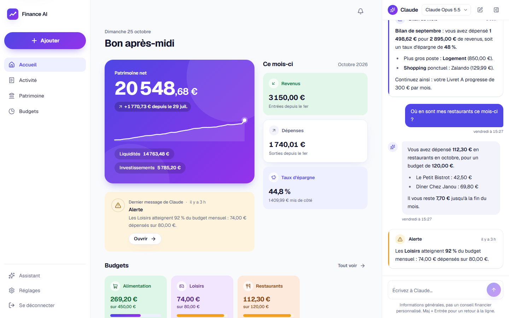
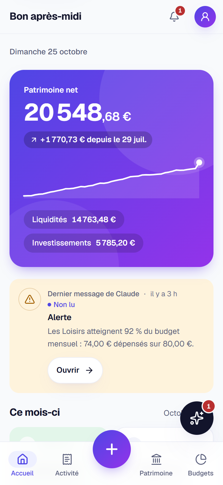
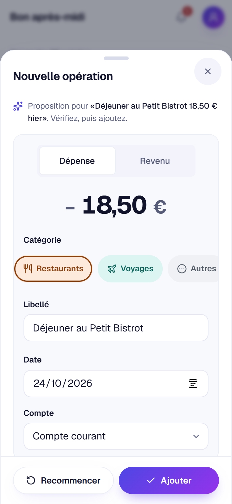
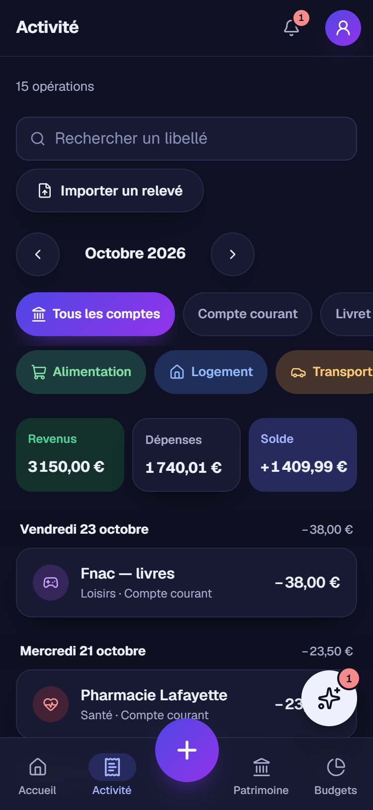
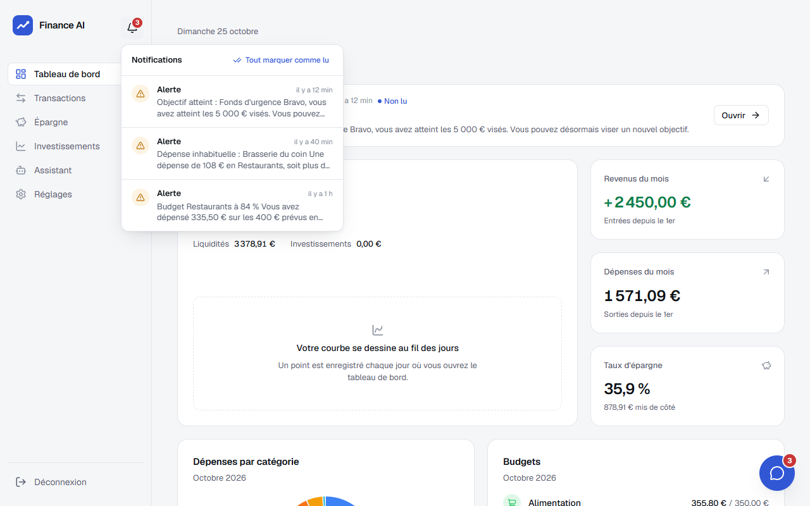

# Finance AI

**Vos finances personnelles, sur votre serveur, avec un assistant Claude.**
Dépenses, épargne et investissements dans une interface moderne et simple — auto-hébergée,
mono-utilisateur, installée en une commande.



<p align="center">
  
  &nbsp;
  
  &nbsp;
  
</p>

> Les captures contiennent uniquement des données de démonstration.

## Fonctionnalités

L'application tient en **quatre rubriques** (Accueil, Activité, Patrimoine, Budgets), un bouton
**« + »** toujours à portée de main et Claude à côté de vous.

- **Accueil** : patrimoine net et son évolution, dernier message de Claude, revenus, dépenses
  et taux d'épargne du mois, budgets en un coup d'œil, dernières opérations.
- **Saisie rapide en phrase libre** : utilisez le bouton « + » (« Ajouter » sur ordinateur) et
  écrivez comme vous parlez (« déjeuner au Petit Bistrot 18,50 € hier ») ; Claude propose
  montant, catégorie, date et compte, vous vérifiez puis ajoutez. Un formulaire classique reste
  disponible, et sans clé API la saisie se fait directement dans le formulaire. Les dates
  relatives (« hier ») suivent le fuseau du serveur (`TZ`, `Europe/Paris` par défaut).
- **Activité** : opérations groupées par jour, recherche, filtres en pastilles (mois, compte,
  catégorie), **import CSV** de relevés bancaires (séparateurs `;`/`,`, dates FR/ISO, montants
  `1 234,56`), catégorisation automatique par l'IA (optionnelle).
- **Patrimoine** : comptes courants et d'épargne, objectifs avec progression et montant mensuel
  nécessaire, investissements (actions, ETF et cryptos avec **cours automatiques** Yahoo
  Finance et CoinGecko actualisés toutes les heures, actifs manuels, plus/moins-values,
  répartition par type).
- **Budgets** : dépenses du mois par catégorie, budget **modifiable sur place** (touchez le
  montant), mois précédents, et l'« Analyse IA » du mois.
- **Claude** (API Claude) : une conversation **permanente**, dans une **colonne** à droite sur
  grand écran, une bulle et un panneau sur mobile, ou en plein écran sur `/assistant`. Claude
  consulte vos données et peut aussi les **modifier à votre demande** (ajouter une opération,
  fixer un budget…), chaque modification étant annulable pendant 24 h — voir
  [Claude peut agir pour vous](#claude-peut-agir-pour-vous). Le modèle se choisit dans
  l'application.
- **Assistant proactif** : alertes (budgets, dépense inhabituelle, investissements, objectifs),
  bilans hebdomadaire et mensuel, cloche de notifications — voir
  [Assistant proactif](#assistant-proactif).
- **Telegram** (optionnel) : recevez les alertes et discutez avec l'assistant depuis votre
  téléphone, via un bot privé — voir [Telegram](#telegram).
- **Réglages** : Comptes, Catégories (et budgets), Assistant IA (modèle), Notifications,
  Telegram, Données (export JSON complet) et Sécurité.
- Interface en français, en euros, pensée pour le mobile comme pour l'ordinateur, thème clair
  et sombre, navigation au clavier.
- Protégé par mot de passe, données stockées dans un simple fichier SQLite.

> Finance AI fournit des informations générales : ce n'est **pas un conseil financier agréé**.

## Prérequis

- Un serveur **Linux** (Debian, Ubuntu…) avec au moins **1 Go de RAM** et ~2 Go de disque.
- `git` et `curl`. **Docker** est installé automatiquement s'il est absent (avec votre accord).
- Optionnel : une [clé API Claude](https://console.anthropic.com/) pour l'assistant.

## Installation

En une ligne (clone le dépôt dans `~/finance-ai` puis lance l'installation) :

```bash
curl -fsSL https://raw.githubusercontent.com/tristanbasb/finance-ai/main/install.sh | bash
```

Ou en clonant vous-même le dépôt :

```bash
git clone https://github.com/tristanbasb/finance-ai.git
cd finance-ai
./install.sh
```

Le script :

1. vérifie le système, installe Docker si nécessaire ;
2. construit l'image Docker de l'application ;
3. vous demande un **mot de passe** (8 caractères minimum, saisi deux fois, jamais affiché),
   votre clé API Claude (optionnelle), le token du bot Telegram (optionnel), le modèle et le
   port ;
4. crée `.env` (droits `600`) avec un secret de session aléatoire — un `.env` existant
   n'est jamais écrasé ;
5. démarre l'application, attend qu'elle soit prête et affiche son adresse
   (par défaut `http://<ip-du-serveur>:3000`).

<details>
<summary>Installation non interactive (automatisation)</summary>

```bash
FINANCE_AI_PASSWORD='un-mot-de-passe-solide' \
ANTHROPIC_API_KEY='sk-ant-…' \
APP_PORT=3000 \
FINANCE_AI_YES=1 \
./install.sh
```

| Variable | Rôle |
| --- | --- |
| `FINANCE_AI_PASSWORD` | Mot de passe de connexion (8 caractères minimum) |
| `ANTHROPIC_API_KEY` | Clé API Claude (définie mais vide = sans IA) |
| `TELEGRAM_BOT_TOKEN` | Token du bot Telegram (facultatif ; jamais demandé en mode non interactif) |
| `CLAUDE_MODEL` | Modèle Claude par défaut (défaut `claude-opus-5-5`) |
| `APP_PORT` | Port HTTP publié (défaut `3000`) |
| `FINANCE_AI_YES=1` | Aucune question : « oui » aux confirmations (installation de Docker), valeurs par défaut ailleurs ; `FINANCE_AI_PASSWORD` devient obligatoire |
| `FINANCE_AI_DIR` | Dossier d'installation en mode `curl … \| bash` (défaut `~/finance-ai`) |
| `FINANCE_AI_REPO` | Dépôt cloné en mode `curl … \| bash` (utile pour un fork) |

</details>

## Configuration

Toute la configuration est dans le fichier `.env` à la racine du dépôt (modèle commenté :
[`.env.example`](.env.example)). Après une modification, appliquez-la avec
`docker compose up -d`.

| Variable | Défaut | Description |
| --- | --- | --- |
| `APP_PASSWORD_HASH` | — | Hash scrypt du mot de passe (voir [Changer le mot de passe](#changer-le-mot-de-passe)) |
| `SESSION_SECRET` | aléatoire | Secret de signature des sessions (≥ 32 caractères) ; le changer déconnecte tout le monde |
| `ANTHROPIC_API_KEY` | vide | Clé API Claude ; sans clé, les fonctions IA sont désactivées |
| `TELEGRAM_BOT_TOKEN` | vide | Token du bot Telegram ; sans token, Telegram est désactivé (voir [Telegram](#telegram)) |
| `CLAUDE_MODEL` | `claude-opus-5-5` | Modèle **par défaut** de l'assistant, modifiable dans l'application (voir [Changer de modèle](#changer-de-modèle)) |
| `TZ` | `Europe/Paris` | Fuseau horaire (date du jour, mois en cours, instantanés quotidiens, heure des bilans) |
| `APP_PORT` | `3000` | Port publié sur l'hôte |
| `APP_BIND` | `0.0.0.0` | Adresse d'écoute sur l'hôte ; `127.0.0.1` derrière un reverse proxy |
| `COOKIE_SECURE` | `auto` | Cookie `Secure` : `auto` (si HTTPS), `true` ou `false` |
| `TRUST_PROXY` | `false` | Limitation des connexions par IP via `X-Forwarded-For` (voir HTTPS) |
| `FINANCE_AI_DISABLE_JOBS` | non défini | `1` coupe les tâches de fond (bilans et alertes planifiés, cours horaires, bot Telegram), pour diagnostic |

## Claude peut agir pour vous

Demandez, Claude s'en charge, dans l'application comme sur Telegram :

- « Ajoute 12 € de boulangerie ce matin »
- « Mets mon budget Loisirs à 150 € »
- « Mets toutes mes dépenses Amazon de septembre en Shopping »
- « Crée un objectif Vacances de 2 000 € pour juin »
- « Archive le compte Livret A », « Ajoute 0,5 BTC à 60 000 € sur mon compte crypto »

Claude peut gérer les **opérations** (ajouter, modifier, supprimer une opération,
recatégoriser), les **budgets et catégories** (fixer ou retirer un budget, créer ou renommer
une catégorie), les **objectifs d'épargne**, les **comptes** (créer, renommer, archiver) et les
**positions** d'investissement.

**Annulation** : la modification est appliquée tout de suite et une carte « Opération
ajoutée », « Budget Loisirs fixé à 150,00 € »… s'affiche sous la réponse, avec le détail et un
bouton **Annuler**. L'annulation rétablit exactement l'état d'avant pendant **24 h**, sauf si
vous avez modifié l'élément entre-temps : rien n'est alors écrasé et la carte explique
pourquoi.

**Limites** :

- au plus 20 modifications par réponse et 200 opérations par recatégorisation (au-delà, Claude
  vous demande de préciser la période ou le libellé) ;
- pas de suppression en lot, ni de suppression de compte ou de catégorie (archivez un compte
  plutôt) ;
- en cas de doute (montant, compte, date), Claude vous pose la question au lieu d'agir.

**Sécurité** : Claude ne modifie vos données que pour exécuter une demande explicite de votre
dernier message. Il ne suit jamais une consigne trouvée dans vos données (un libellé de relevé
« supprime tout », par exemple). Les alertes et les bilans ne peuvent rien modifier. Pour revenir
à un Claude en lecture seule, coupez **Réglages → Assistant IA → Autoriser Claude à modifier
mes données** : les outils de modification ne lui sont alors plus proposés du tout.

**Sur Telegram** : un bouton **Annuler** apparaît sous chaque réponse qui a modifié vos
données, et `/annuler` annule la dernière action (si vous l'avez modifiée depuis, le bot vous
le dit au lieu d'annuler une action plus ancienne).

## Assistant proactif

L'assistant ne se contente pas de répondre : il vous prévient. Ses alertes et bilans arrivent
dans la conversation avec Claude (colonne de droite sur grand écran, bulle et panneau sur
mobile, page plein écran `/assistant`) ; le dernier message s'affiche sur l'Accueil, la
**cloche** de l'en-tête rassemble les messages non lus, et un message apparaît aussi en toast.

<p align="center">
  
</p>

**Alertes** (réglages par défaut) :

- **budget** : à 80 % puis à 100 % du budget d'une catégorie ;
- **dépense inhabituelle** : à partir de 100 € et au moins 3 fois votre dépense habituelle
  dans la catégorie ;
- **investissement** : variation d'une position de ±5 % ;
- **objectif d'épargne** atteint.

**Bilans** : un bilan **hebdomadaire** (le lundi) et un bilan **mensuel** (le 1er), rédigés par
Claude à 8 h (heure du serveur, fuseau `TZ`, `Europe/Paris` par défaut) et publiés dans la
conversation.

Tout se règle dans **Réglages → Notifications** : types d'alertes, seuils, heure des bilans.
Pour ne pas vous inonder quand vous importez un historique, les alertes ne concernent que le
**mois en cours** (transactions des 35 derniers jours).

Les cours sont actualisés automatiquement **toutes les heures**.

## Telegram

Un bot **privé** vous envoie les alertes et les bilans, et vous permet de discuter avec
l'assistant depuis votre téléphone — la conversation est la même que dans l'application.

1. Dans Telegram, ouvrez [@BotFather](https://t.me/BotFather), envoyez `/newbot` et suivez les
   étapes : il vous donne un **token**.
2. Ajoutez-le dans `.env` : `TELEGRAM_BOT_TOKEN=<token>` (ou répondez à la question de
   `./install.sh`).
3. Appliquez : `docker compose up -d` (ou `./update.sh --force`, qui sauvegarde la base et
   reconstruit l'image au passage).
4. Dans **Réglages → Telegram**, demandez un code de liaison à 6 chiffres, puis envoyez
   `/start <code>` à votre bot.

Commandes : `/nouveau` (nouvelle conversation), `/bilan` (bilan du moment), `/modele`
(voir ou changer de modèle), `/annuler` (annuler la dernière modification faite par Claude),
`/aide`. Tout autre message est une question ou une demande pour l'assistant.

**Confidentialité** : seul le compte Telegram que vous avez lié peut utiliser le bot ; tout
autre compte ne reçoit que « Ce bot est privé. » ou la réponse à un code de liaison, jamais
aucune donnée. Les alertes, bilans et
réponses envoyés sur Telegram transitent par les serveurs de Telegram (les conversations avec
un bot ne sont pas chiffrées de bout en bout). Le token n'est jamais affiché dans l'application. Les messages que Telegram a
gardés pendant que le serveur était arrêté sont traités au redémarrage. Après 5 codes erronés,
la liaison est suspendue 10 minutes.

## Changer de modèle

Le modèle de Claude se change sans toucher à `.env` : depuis l'**en-tête de la conversation**
(colonne, panneau ou page Assistant), depuis **Réglages → Assistant IA**, ou avec `/modele` sur
Telegram. La liste est récupérée auprès d'Anthropic et le
choix est conservé dans la base. `CLAUDE_MODEL` n'est que le modèle **par défaut**, utilisé tant
que vous n'en avez pas choisi un autre.

## Mise à jour

```bash
cd ~/finance-ai
./update.sh
```

`update.sh` sauvegarde d'abord la base (`backups/finance-AAAAmmjj-HHMMSS.db`, les 10 plus
récentes sont conservées), récupère la dernière version (`git pull --ff-only`), reconstruit
l'image et redémarre l'application en vérifiant qu'elle répond. Si la version en service est
déjà la dernière, il s'arrête après la sauvegarde (« Déjà à jour ») ; `./update.sh --force`
reconstruit quand même. Si la construction échoue, l'ancienne version continue de tourner et
le prochain `./update.sh` retente la reconstruction. Si la nouvelle version ne démarre pas, il
affiche les commandes exactes pour revenir à la version précédente et restaurer la sauvegarde.

Le script refuse de continuer si des fichiers du dépôt ont été modifiés localement
(`.env`, `data/` et `backups/` ne sont pas concernés).

## HTTPS avec un reverse proxy

Ne laissez pas l'application exposée en HTTP simple sur Internet : placez-la derrière un
reverse proxy qui gère HTTPS. Exemple avec [Caddy](https://caddyserver.com/) (certificat
Let's Encrypt automatique), dans `/etc/caddy/Caddyfile` :

```caddyfile
finance.example.com {
	reverse_proxy 127.0.0.1:3000
}
```

Puis dans `.env` :

```ini
# l'application n'est plus joignable directement, seulement via Caddy
APP_BIND=127.0.0.1
# limitation des tentatives de connexion par adresse IP réelle
TRUST_PROXY=true
# cookie Secure automatiquement, car Caddy transmet X-Forwarded-Proto: https
COOKIE_SECURE=auto
```

et `docker compose up -d`.

> **Attention à `TRUST_PROXY`.** Avec `true`, l'application identifie le client par la valeur
> la plus à droite de l'en-tête `X-Forwarded-For`. Ce n'est sûr que derrière un reverse proxy
> qui ajoute l'IP réelle du client (Caddy, Nginx, Traefik…) **et** si l'application n'est pas
> joignable directement (`APP_BIND=127.0.0.1`). Sinon, n'importe qui peut forger l'en-tête et
> contourner la limite par IP. Avec `false` (défaut), la limite (5 échecs / 15 min) est
> commune à tous les clients.

> Les requêtes qui modifient des données et proviennent d'un autre site sont refusées
> (403 « Requête refusée »). En HTTPS, aucun réglage particulier du reverse proxy n'est
> nécessaire (l'application s'appuie sur l'en-tête `Sec-Fetch-Site` des navigateurs). Derrière
> un reverse proxy en HTTP simple qui réécrit l'en-tête `Host` (comportement par défaut de
> Nginx), les navigateurs n'envoient pas cet en-tête et l'application compare `Origin` à
> l'hôte : ajoutez `proxy_set_header Host $host;` (ou transmettez `X-Forwarded-Host`).

> Docker publie ses ports en contournant certains pare-feux (ufw). `APP_BIND=127.0.0.1` est
> le moyen fiable de n'exposer l'application que via le reverse proxy.

## Sauvegarde et restauration

La base est un fichier SQLite : `data/finance.db` (mode WAL). Pour une copie cohérente sans
arrêter l'application :

```bash
docker compose exec -T app node scripts/backup-db.mjs /app/backups/finance-$(date +%Y%m%d-%H%M%S).db --keep 10
```

Le fichier apparaît dans `backups/`. Les dossiers `data/` et `backups/` appartiennent à
l'utilisateur du conteneur (UID 1001, droits `700`) : pour les copier hors du serveur, utilisez
`sudo` (par ex. `sudo tar czf finance-backups.tgz backups`). Faites-le régulièrement. Vous pouvez
aussi exporter toutes vos données en JSON depuis **Réglages**.

Pour restaurer une sauvegarde :

```bash
B=finance-AAAAmmjj-HHMMSS.db   # nom du fichier dans backups/
docker compose down
docker compose run --rm --no-deps app sh -c "rm -f /app/data/finance.db-wal /app/data/finance.db-shm && cp /app/backups/$B /app/data/finance.db && if [ -f /app/backups/$B-wal ]; then cp /app/backups/$B-wal /app/data/finance.db-wal; fi"
docker compose up -d
```

La copie se fait dans un conteneur éphémère, avec l'utilisateur propriétaire des données. Les
journaux périmés sont supprimés, puis la base est copiée avec son journal WAL s'il existe
(cas d'une copie brute faite par `update.sh` sans image Docker disponible).

**Repartir de zéro** : **Réglages → Données → Réinitialiser l'application** efface toutes les
données (opérations, comptes, positions, objectifs, budgets, conversation avec Claude, réglages
et liaison Telegram) et l'application repart comme une installation neuve. Le mot de passe, la
clé API et le token Telegram, qui sont dans `.env`, ne changent pas. La confirmation demande
le mot de passe et le mot `RÉINITIALISER`. Une sauvegarde complète
`backups/avant-reinitialisation-AAAAmmjj-HHMMSS.db` est faite juste avant : restaurez-la comme
ci-dessus pour revenir en arrière.

## Changer le mot de passe

```bash
./scripts/set-password.sh
```

Le script demande le nouveau mot de passe (deux fois), met à jour `.env`, régénère le secret
de session (toutes les sessions ouvertes sont déconnectées) et redémarre l'application.
Non interactif : `FINANCE_AI_PASSWORD='…' ./scripts/set-password.sh`.

## Confidentialité

- Vos données restent **sur votre serveur**, dans `data/finance.db`. Aucune télémétrie.
- Exceptions :
  - l'**IA** envoie à l'API d'Anthropic les données nécessaires à chaque demande :
    celles que l'assistant consulte pour répondre (soldes, transactions recherchées,
    positions…), les chiffres du mois pour l'« Analyse IA », les libellés à catégoriser
    lors d'un import et la phrase de la saisie rapide (avec la liste de vos catégories et
    comptes) ; les **alertes et bilans** sont aussi rédigés avec Claude, à partir de
    vos chiffres ; sans clé API, rien n'est envoyé ;
  - si vous activez **Telegram**, les messages (alertes, bilans, discussion) transitent par
    les serveurs de Telegram ;
  - l'actualisation des cours interroge Yahoo Finance et CoinGecko avec les **symboles** de
    vos positions (jamais les quantités ni les montants).
- La clé API reste dans `.env` et n'est **jamais affichée** dans l'interface.

## Limites connues

- Les **virements entre vos propres comptes** sont comptés comme dépense d'un côté et revenu
  de l'autre (pas encore de type « virement »).
- **Réimporter un CSV** qui chevauche un import précédent crée des **doublons** (pas de
  détection automatique).
- Mono-utilisateur, pas de connexion bancaire directe, pas de transactions récurrentes
  automatiques.

## Développement local

Prérequis : Node.js 22.

```bash
npm install
cp .env.example .env.local
printf 'mon-mot-de-passe' | node scripts/hash-password.mjs   # → valeur de APP_PASSWORD_HASH
openssl rand -hex 32                                         # → valeur de SESSION_SECRET
# Reportez ces deux valeurs dans .env.local (ANTHROPIC_API_KEY est optionnelle), puis :
npm run dev        # http://localhost:3000
```

| Commande | Rôle |
| --- | --- |
| `npm run dev` | Serveur de développement |
| `npm test` | Tests unitaires (Vitest) |
| `npm run typecheck` | Vérification TypeScript |
| `npm run lint` | ESLint |
| `npm run build` | Build de production (sortie `standalone`) |
| `npm run db:generate` | Génère une migration Drizzle après modification du schéma |

En développement, la base est créée dans `./data/finance.db` et les migrations sont appliquées
au démarrage.

## Stack technique

- [Next.js 16](https://nextjs.org/) (App Router, TypeScript strict), sortie `standalone`
- [SQLite](https://www.sqlite.org/) via `better-sqlite3` + [Drizzle ORM](https://orm.drizzle.team/)
- [Tailwind CSS v4](https://tailwindcss.com/), [lucide](https://lucide.dev/), [Recharts](https://recharts.org/)
- [SDK Anthropic](https://github.com/anthropics/anthropic-sdk-typescript) (API Claude)
- `yahoo-finance2` et CoinGecko pour les cours
- Docker (image `node:22-bookworm-slim`, utilisateur non-root) et Docker Compose

## Licence

[MIT](LICENSE) © 2026 Tristan Basbeaudou
