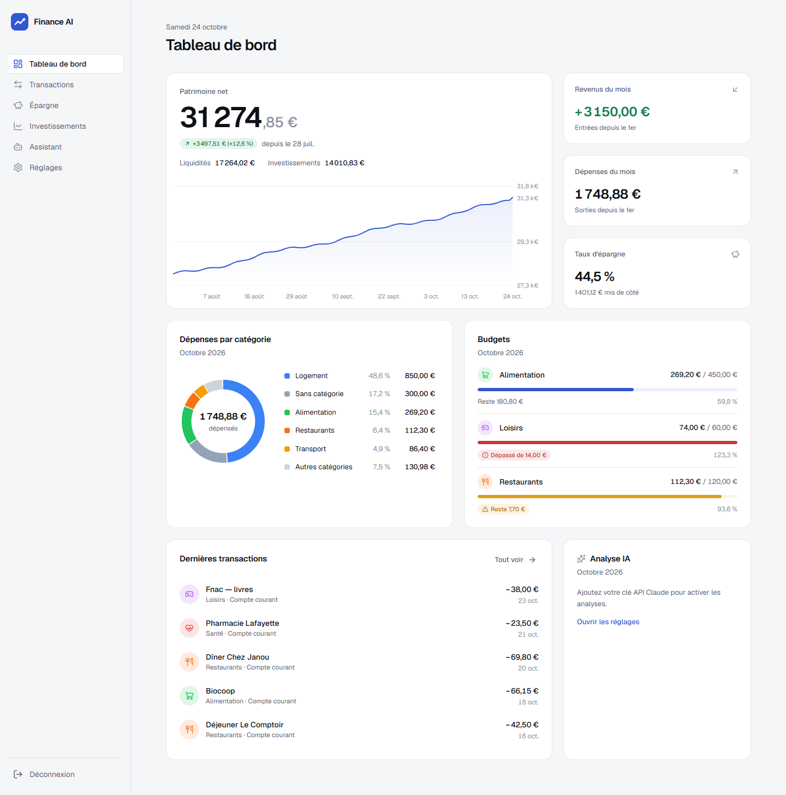
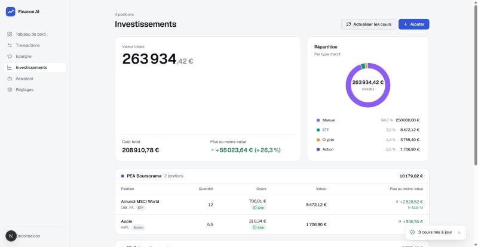
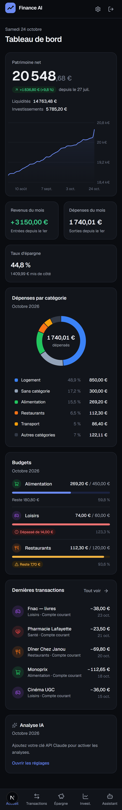

# Finance AI

**Vos finances personnelles, sur votre serveur, avec un assistant Claude.**
Dépenses, épargne et investissements dans une interface moderne et simple — auto-hébergée,
mono-utilisateur, installée en une commande.



<p align="center">
  
  &nbsp;
  
</p>

> Les captures contiennent uniquement des données de démonstration.

## Fonctionnalités

- **Tableau de bord** : patrimoine net et son évolution, revenus et dépenses du mois, taux
  d'épargne, dépenses par catégorie, suivi des budgets, dernières transactions.
- **Transactions** : saisie rapide, filtres (mois, compte, catégorie, recherche),
  **import CSV** de relevés bancaires (séparateurs `;`/`,`, dates FR/ISO, montants `1 234,56`),
  catégorisation automatique par l'IA (optionnelle).
- **Épargne** : comptes d'épargne et objectifs avec progression et montant mensuel nécessaire.
- **Investissements** : actions, ETF et cryptos avec **cours automatiques** (Yahoo Finance,
  CoinGecko), actifs manuels (immobilier…), plus/moins-values, répartition par type.
- **Assistant IA** (API Claude) : posez vos questions sur vos finances, analyse du mois.
  L'IA consulte vos données en **lecture seule** et ne les modifie jamais.
- **Réglages** : comptes, catégories et budgets, export JSON complet.
- Interface en français, en euros, responsive (mobile), thème clair et sombre.
- Protégé par mot de passe, données stockées dans un simple fichier SQLite.

> Finance AI fournit des informations générales : ce n'est **pas un conseil financier agréé**.

## Prérequis

- Un serveur **Linux** (Debian, Ubuntu…) avec au moins **1 Go de RAM** et ~2 Go de disque.
- `git` et `curl`. **Docker** est installé automatiquement s'il est absent (avec votre accord).
- Optionnel : une [clé API Claude](https://console.anthropic.com/) pour l'assistant.

## Installation

En une ligne (clone le dépôt dans `~/finance-ai` puis lance l'installation) :

```bash
curl -fsSL https://raw.githubusercontent.com/tristanbasb/finance-ai/main/install.sh | bash
```

Ou en clonant vous-même le dépôt :

```bash
git clone https://github.com/tristanbasb/finance-ai.git
cd finance-ai
./install.sh
```

Le script :

1. vérifie le système, installe Docker si nécessaire ;
2. construit l'image Docker de l'application ;
3. vous demande un **mot de passe** (8 caractères minimum, saisi deux fois, jamais affiché),
   votre clé API Claude (optionnelle), le modèle et le port ;
4. crée `.env` (droits `600`) avec un secret de session aléatoire — un `.env` existant
   n'est jamais écrasé ;
5. démarre l'application, attend qu'elle soit prête et affiche son adresse
   (par défaut `http://<ip-du-serveur>:3000`).

<details>
<summary>Installation non interactive (automatisation)</summary>

```bash
FINANCE_AI_PASSWORD='un-mot-de-passe-solide' \
ANTHROPIC_API_KEY='sk-ant-…' \
APP_PORT=3000 \
FINANCE_AI_YES=1 \
./install.sh
```

| Variable | Rôle |
| --- | --- |
| `FINANCE_AI_PASSWORD` | Mot de passe de connexion (8 caractères minimum) |
| `ANTHROPIC_API_KEY` | Clé API Claude (définie mais vide = sans IA) |
| `CLAUDE_MODEL` | Modèle Claude (défaut `claude-opus-5-5`) |
| `APP_PORT` | Port HTTP publié (défaut `3000`) |
| `FINANCE_AI_YES=1` | Aucune question : « oui » aux confirmations (installation de Docker), valeurs par défaut ailleurs ; `FINANCE_AI_PASSWORD` devient obligatoire |
| `FINANCE_AI_DIR` | Dossier d'installation en mode `curl … \| bash` (défaut `~/finance-ai`) |
| `FINANCE_AI_REPO` | Dépôt cloné en mode `curl … \| bash` (utile pour un fork) |

</details>

## Configuration

Toute la configuration est dans le fichier `.env` à la racine du dépôt (modèle commenté :
[`.env.example`](.env.example)). Après une modification, appliquez-la avec
`docker compose up -d`.

| Variable | Défaut | Description |
| --- | --- | --- |
| `APP_PASSWORD_HASH` | — | Hash scrypt du mot de passe (voir [Changer le mot de passe](#changer-le-mot-de-passe)) |
| `SESSION_SECRET` | aléatoire | Secret de signature des sessions (≥ 32 caractères) ; le changer déconnecte tout le monde |
| `ANTHROPIC_API_KEY` | vide | Clé API Claude ; sans clé, les fonctions IA sont désactivées |
| `CLAUDE_MODEL` | `claude-opus-5-5` | Modèle utilisé par l'assistant |
| `TZ` | `Europe/Paris` | Fuseau horaire (date du jour, mois en cours, instantanés quotidiens) |
| `APP_PORT` | `3000` | Port publié sur l'hôte |
| `APP_BIND` | `0.0.0.0` | Adresse d'écoute sur l'hôte ; `127.0.0.1` derrière un reverse proxy |
| `COOKIE_SECURE` | `auto` | Cookie `Secure` : `auto` (si HTTPS), `true` ou `false` |
| `TRUST_PROXY` | `false` | Limitation des connexions par IP via `X-Forwarded-For` (voir HTTPS) |

## Mise à jour

```bash
cd ~/finance-ai
./update.sh
```

`update.sh` sauvegarde d'abord la base (`backups/finance-AAAAmmjj-HHMMSS.db`, les 10 plus
récentes sont conservées), récupère la dernière version (`git pull --ff-only`), reconstruit
l'image et redémarre l'application en vérifiant qu'elle répond. Si la version en service est
déjà la dernière, il s'arrête après la sauvegarde (« Déjà à jour ») ; `./update.sh --force`
reconstruit quand même. Si la construction échoue, l'ancienne version continue de tourner et
le prochain `./update.sh` retente la reconstruction. Si la nouvelle version ne démarre pas, il
affiche les commandes exactes pour revenir à la version précédente et restaurer la sauvegarde.

Le script refuse de continuer si des fichiers du dépôt ont été modifiés localement
(`.env`, `data/` et `backups/` ne sont pas concernés).

## HTTPS avec un reverse proxy

Ne laissez pas l'application exposée en HTTP simple sur Internet : placez-la derrière un
reverse proxy qui gère HTTPS. Exemple avec [Caddy](https://caddyserver.com/) (certificat
Let's Encrypt automatique), dans `/etc/caddy/Caddyfile` :

```caddyfile
finance.example.com {
	reverse_proxy 127.0.0.1:3000
}
```

Puis dans `.env` :

```ini
# l'application n'est plus joignable directement, seulement via Caddy
APP_BIND=127.0.0.1
# limitation des tentatives de connexion par adresse IP réelle
TRUST_PROXY=true
# cookie Secure automatiquement, car Caddy transmet X-Forwarded-Proto: https
COOKIE_SECURE=auto
```

et `docker compose up -d`.

> **Attention à `TRUST_PROXY`.** Avec `true`, l'application identifie le client par la valeur
> la plus à droite de l'en-tête `X-Forwarded-For`. Ce n'est sûr que derrière un reverse proxy
> qui ajoute l'IP réelle du client (Caddy, Nginx, Traefik…) **et** si l'application n'est pas
> joignable directement (`APP_BIND=127.0.0.1`). Sinon, n'importe qui peut forger l'en-tête et
> contourner la limite par IP. Avec `false` (défaut), la limite (5 échecs / 15 min) est
> commune à tous les clients.

> **Le proxy doit transmettre l'en-tête `Host` d'origine** (Caddy le fait par défaut ; avec
> Nginx : `proxy_set_header Host $host;`). Les requêtes qui modifient des données sont refusées
> (403 « Requête refusée ») quand leur `Origin` ne correspond pas à l'hôte demandé : c'est la
> protection contre les requêtes envoyées depuis un autre site. Si le proxy réécrit `Host`,
> `X-Forwarded-Host` est utilisé à la place avec `TRUST_PROXY=true`.

> Docker publie ses ports en contournant certains pare-feux (ufw). `APP_BIND=127.0.0.1` est
> le moyen fiable de n'exposer l'application que via le reverse proxy.

## Sauvegarde et restauration

La base est un fichier SQLite : `data/finance.db` (mode WAL). Pour une copie cohérente sans
arrêter l'application :

```bash
docker compose exec -T app node scripts/backup-db.mjs /app/backups/finance-$(date +%Y%m%d-%H%M%S).db --keep 10
```

Le fichier apparaît dans `backups/`. Les dossiers `data/` et `backups/` appartiennent à
l'utilisateur du conteneur (UID 1001, droits `700`) : pour les copier hors du serveur, utilisez
`sudo` (par ex. `sudo tar czf finance-backups.tgz backups`). Faites-le régulièrement. Vous pouvez
aussi exporter toutes vos données en JSON depuis **Réglages**.

Pour restaurer une sauvegarde :

```bash
B=finance-AAAAmmjj-HHMMSS.db   # nom du fichier dans backups/
docker compose down
docker compose run --rm --no-deps app sh -c "rm -f /app/data/finance.db-wal /app/data/finance.db-shm && cp /app/backups/$B /app/data/finance.db && if [ -f /app/backups/$B-wal ]; then cp /app/backups/$B-wal /app/data/finance.db-wal; fi"
docker compose up -d
```

La copie se fait dans un conteneur éphémère, avec l'utilisateur propriétaire des données. Les
journaux périmés sont supprimés, puis la base est copiée avec son journal WAL s'il existe
(cas d'une copie brute faite par `update.sh` sans image Docker disponible).

## Changer le mot de passe

```bash
./scripts/set-password.sh
```

Le script demande le nouveau mot de passe (deux fois), met à jour `.env`, régénère le secret
de session (toutes les sessions ouvertes sont déconnectées) et redémarre l'application.
Non interactif : `FINANCE_AI_PASSWORD='…' ./scripts/set-password.sh`.

## Confidentialité

- Vos données restent **sur votre serveur**, dans `data/finance.db`. Aucune télémétrie.
- Exceptions :
  - l'**IA** envoie à l'API d'Anthropic les données nécessaires à chaque demande :
    celles que l'assistant consulte pour répondre (soldes, transactions recherchées,
    positions…), les chiffres du mois pour l'« Analyse IA » et les libellés à catégoriser
    lors d'un import ; sans clé API, rien n'est envoyé ;
  - l'actualisation des cours interroge Yahoo Finance et CoinGecko avec les **symboles** de
    vos positions (jamais les quantités ni les montants).
- La clé API reste dans `.env` et n'est **jamais affichée** dans l'interface.

## Limites connues

- Les **virements entre vos propres comptes** sont comptés comme dépense d'un côté et revenu
  de l'autre (pas encore de type « virement »).
- **Réimporter un CSV** qui chevauche un import précédent crée des **doublons** (pas de
  détection automatique).
- Mono-utilisateur, pas de connexion bancaire directe, pas de transactions récurrentes
  automatiques.

## Développement local

Prérequis : Node.js 22.

```bash
npm install
cp .env.example .env.local
printf 'mon-mot-de-passe' | node scripts/hash-password.mjs   # → valeur de APP_PASSWORD_HASH
openssl rand -hex 32                                         # → valeur de SESSION_SECRET
# Reportez ces deux valeurs dans .env.local (ANTHROPIC_API_KEY est optionnelle), puis :
npm run dev        # http://localhost:3000
```

| Commande | Rôle |
| --- | --- |
| `npm run dev` | Serveur de développement |
| `npm test` | Tests unitaires (Vitest) |
| `npm run typecheck` | Vérification TypeScript |
| `npm run lint` | ESLint |
| `npm run build` | Build de production (sortie `standalone`) |
| `npm run db:generate` | Génère une migration Drizzle après modification du schéma |

En développement, la base est créée dans `./data/finance.db` et les migrations sont appliquées
au démarrage.

## Stack technique

- [Next.js 16](https://nextjs.org/) (App Router, TypeScript strict), sortie `standalone`
- [SQLite](https://www.sqlite.org/) via `better-sqlite3` + [Drizzle ORM](https://orm.drizzle.team/)
- [Tailwind CSS v4](https://tailwindcss.com/), [lucide](https://lucide.dev/), [Recharts](https://recharts.org/)
- [SDK Anthropic](https://github.com/anthropics/anthropic-sdk-typescript) (API Claude)
- `yahoo-finance2` et CoinGecko pour les cours
- Docker (image `node:22-bookworm-slim`, utilisateur non-root) et Docker Compose

## Licence

[MIT](LICENSE) © 2026 Tristan Basbeaudou
